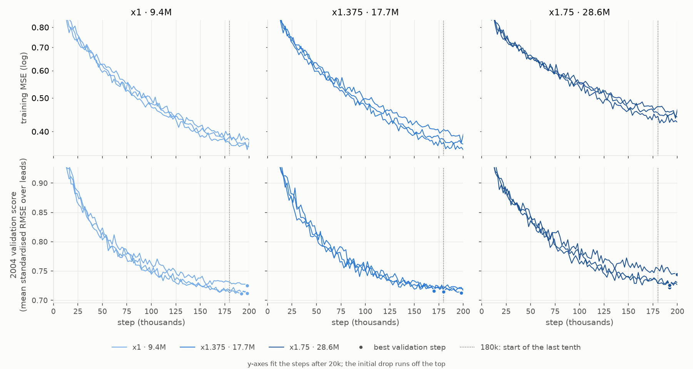

# KA-Ocean model size on 100 CESM2 years

KA-Ocean (method A: U-Net state, lead evolution, `ka_flow` kriging read-out) on `cesm2_vlong_uniform`, training window 1904-2003, 200,000 steps of 1,024 queries, leads 0, 1, 3 and 6 months in one model. Each run's checkpoint is chosen on target year 2004; 2005 is held out of that choice. Spec: `docs/superpowers/specs/2026-10-23-ka-size-study-design.md`.

Seeds finished: x1 · 9.4M 3, x1.375 · 17.7M 3, x1.75 · 28.6M 3.

## Sizes

| size | parameters | hours a run | best steps | 2004 score (chose) | 2005 score (held out) |
|---|---|---|---|---|---|
| x1 · 9.4M | 9.4M | 6.1 ± 0.2 | 198000, 192000, 198000 | 0.7225 ± 0.0073 | 0.7231 ± 0.0162 |
| x1.375 · 17.7M | 17.7M | 6.6 ± 0.6 | 198000, 180000, 170000 | 0.7210 ± 0.0022 | 0.7207 ± 0.0023 |
| x1.75 · 28.6M | 28.6M | 6.3 ± 1.5 | 192000, 192000, 200000 | 0.7380 ± 0.0122 | 0.7104 ± 0.0059 |

Score: mean over leads of the per-variable standardised RMSE on every cell, mean ± sd over seeds.

## Decision

* Bigger helps: **no** -- x1.75's 2005 score is +0.0127 below x1's; the larger seed sd is 0.0162.
* Best size (lowest 2004 score): **x1.375 · 17.7M**.

## 2005 by lead: temperature RMSE (°C)

| lead | persisted OI | climatology | x1 · 9.4M | x1.375 · 17.7M | x1.75 · 28.6M |
|---|---|---|---|---|---|
| 0 | 0.0860 | 0.6528 | 0.0525 ± 0.0005 | 0.0526 ± 0.0011 **best** | 0.0556 ± 0.0012 |
| 1 | 0.3101 | 0.6528 | 0.2536 ± 0.0034 | 0.2473 ± 0.0023 **best** | 0.2491 ± 0.0015 |
| 3 | 0.5235 | 0.6528 | 0.4108 ± 0.0146 | 0.4028 ± 0.0035 **best** | 0.4005 ± 0.0080 |
| 6 | 0.6794 | 0.6528 | 0.5184 ± 0.0219 | 0.5214 ± 0.0091 **best** | 0.4977 ± 0.0125 |

## 2005 by lead: salinity RMSE (PSU)

| lead | persisted OI | climatology | x1 · 9.4M | x1.375 · 17.7M | x1.75 · 28.6M |
|---|---|---|---|---|---|
| 0 | 0.0226 | 0.1119 | 0.0130 ± 0.0001 | 0.0132 ± 0.0003 **best** | 0.0134 ± 0.0001 |
| 1 | 0.0529 | 0.1119 | 0.0417 ± 0.0005 | 0.0412 ± 0.0002 **best** | 0.0412 ± 0.0004 |
| 3 | 0.0902 | 0.1119 | 0.0647 ± 0.0017 | 0.0649 ± 0.0006 **best** | 0.0641 ± 0.0005 |
| 6 | 0.1176 | 0.1119 | 0.0839 ± 0.0038 | 0.0843 ± 0.0013 **best** | 0.0805 ± 0.0006 |

## Convergence

`171_size_curves.py`: training MSE and the 2004 validation score per run; a best step after 180k means still improving.
